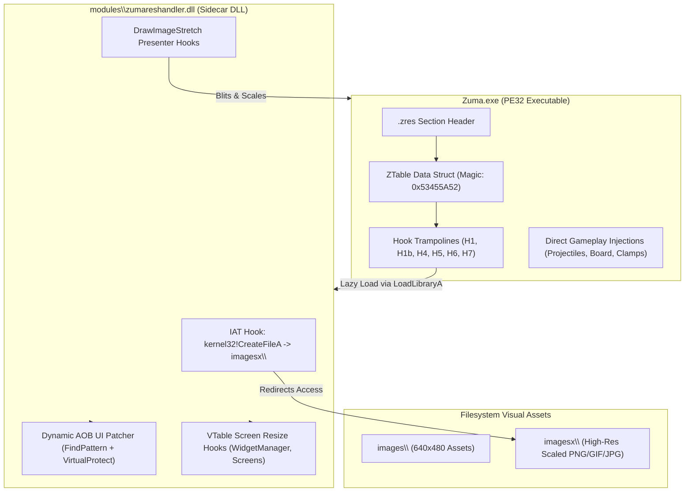
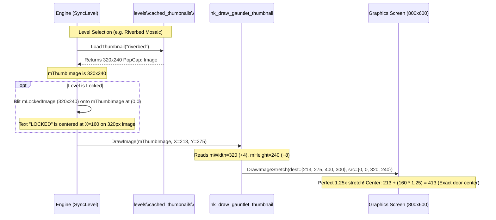

# Zuma Deluxe Custom Resolution System: Architecture, Reverse Engineering, and Implementation Reference

## 1. Executive Summary and System Architecture

### 1.1 Purpose and Scope
This document details the reverse engineering, binary instrumentation, and dynamic sidecar architecture developed to upgrade **Zuma Deluxe (v1.0.0.1 retail, PopCap Games, 2003)** from its legacy, hardcoded $640 \times 480$ 4:3 display mode to arbitrary modern resolutions (with primary verification at $800 \times 600$ and support for widescreen letterbox/pillarbox presentation).

The entire system is implemented **without source code**, adhering strictly to the following architectural constraints:
* **Zero Hardcoded Runtime Addresses**: No static Relative Virtual Addresses (RVAs) or Absolute Virtual Addresses (AVAs) are hardcoded into patch sites. All target sites are resolved dynamically via unique Ahead-Of-Time/Just-In-Time Array-Of-Bytes (AOB) signatures verified via disassembler instruction semantics.
* **Immutable Baseline Architecture**: The original vanilla executable is never permanently overwritten without a clean, untouched backup preserved in `modules\bak\Zuma.exe`.
* **Idempotency and Non-Destructive Hooking**: Executables can be rebuilt or repatched repeatedly without degrading PE headers or creating dangling trampolines.
* **Separation of Presentation and State**: Internal engine simulation loops (ball pathing, particle speeds, level descriptors) remain mathematically deterministic, while the presentation backbuffers, rendering clip rects, asset loaders, and UI layout trees are seamlessly translated.

---

### 1.2 High-Level Architecture Overview

The resolution scaling system operates through a collaborative two-tier model:



1. **Host Executable Injection (`.zres` PE Section)**:
   A lightweight, self-contained PE section (`.zres`, 0x1000 bytes virtual size) is appended to `Zuma.exe`. This section contains a descriptor table (`ZTable`), lazy-loading trampolines for core DirectDraw/Graphics calls, and immediate value overrides.
2. **Dynamic Sidecar DLL (`modules\\zumareshandler.dll`)**:
   Upon the first graphics invocation, the `.zres` trampoline executes a thread-safe `LoadLibraryA` call to inject the sidecar DLL. The sidecar installs an Import Address Table (IAT) hook for filesystem redirection, dynamically resolves UI coordinates using signature scans, overrides virtual function tables (V-Tables) for widget containers, and manages coordinate transformation.

---

## 2. PopCap Framework Internal Layouts and Reversing Discoveries

Detailed decompilation of the executable via Ghidra and disassembly analysis with Capstone revealed key memory layouts and object models used across the PopCap Games Framework (2003 era).

### 2.1 `PopCap::Image` Object Memory Layout
The base image class (`Image`, inherited by `MemoryImage` and `DDImage`) possesses a strict, unpadded 32-bit field structure:

```
Offset   Size   Type           Description
------------------------------------------------------------------------
+0x00    4      void*          Virtual Method Table (vtable)
+0x04    4      uint32_t       mWidth   (Image horizontal pixel count)
+0x08    4      uint32_t       mHeight  (Image vertical pixel count)
+0x0C    4      uint32_t       mNumCols (Spritesheet column count)
+0x10    4      uint32_t       mNumRows (Spritesheet row count)
```

#### Engine Verification
The engine's native inlined getters directly prove this struct layout:
* **`Image::GetWidth()`** located at `0x00447EA0`:
  ```assembly
  0x00447EA0:  mov eax, dword ptr [ecx + 0x04]
  0x00447EA3:  ret
  ```
* **`Image::GetHeight()`** located at `0x00447EB0`:
  ```assembly
  0x00447EB0:  mov eax, dword ptr [ecx + 0x08]
  0x00447EB3:  ret
  ```

> [!CAUTION]
> Reading `+0x08` and `+0x0C` as width and height (a common pitfall when assuming a leading vtable + dimension pair) erroneously reads `mHeight` and `mNumCols` (typically `1`). When fed into stretching routines, this causes single-line vertical sampling artifacts (scanlines/stripes).

---

### 2.2 `PopCap::Graphics` Object Memory Layout
The `Graphics` context object is passed across all `Draw`, `FillRect`, and `DrawString` calls:

```
Offset   Size   Type           Description
------------------------------------------------------------------------
+0x00    4      void*          Virtual Method Table (vtable)
+0x04    4      void*          mTargetImage (Pointer to PopCap::Image target)
+0x08    4      int32_t        mTransX (Current horizontal canvas translation)
+0x0C    4      int32_t        mTransY (Current vertical canvas translation)
+0x10    16     int32_t[4]     mClipRect (mX, mY, mWidth, mHeight in absolute space)
+0x20    16     int32_t[4]     mColor (R, G, B, A normalized or 0-255)
+0x30    4      void*          mFont (Pointer to active PopCap::Font)
+0x44    4      void*          mDrawMode / Blend state
+0x48    1      uint8_t        mColorizeImages flag
+0x49    1      uint8_t        mFastStretch flag
```

#### Graphics Stretching Primitive (`DrawImageStretch`)
Located at `0x0044D5F0`, the engine's arbitrary scaling function signature is:
```c
void __thiscall PopCap::Graphics::DrawImageStretch(
    void *this,              // ECX: PopCap::Graphics instance
    void *img,               // Stack [EBP+0x08]: PopCap::Image*
    const int32_t *destRect, // Stack [EBP+0x0C]: {X, Y, W, H}
    const int32_t *srcRect   // Stack [EBP+0x10]: {X, Y, W, H}
);
```

---

### 2.3 `PopCap::WidgetManager` and Hierarchy
The root container managing screen states (`MainMenu`, `AdventureScreen`, `GauntletScreen`, `Board`) is the `WidgetManager`:
* `+0x0C`: Pointer to `ZumaApp` instance (`app`).
* `+0x10`: Primary destination backbuffer `PopCap::DDImage*`.
* `+0x1C`: Backbuffer width (`cur_w`).
* `+0x20`: Backbuffer height (`cur_h`).
* `+0x34`: Circular linked-list sentinel node managing child widgets. Each list node has `+0x00`: Next node, `+0x08`: `Widget*`.
* `Widget+0x1C`: `mIsTransparent` / transient flag. If any widget has `mIsTransparent == 1`, `DrawScreen` diverts blits into temporary clipping bounds. The `Unclip` routine temporarily clears this flag during presentation to guarantee full-resolution rendering without perimeter cropping.

---

## 3. PE Modification and Section `.zres` Specifications

### 3.1 Data Structure Specification: `ZTable`
The initial $0x48$ bytes of the `.zres` section represent the shared synchronization and configuration block between the host PE and the sidecar DLL:

```c
typedef struct {
    uint32_t magic;                    // +0x00: Magic header 0x53455A52 ('ZRES')
    void    *initdx;                   // +0x04: Target of InitDirectX
    void    *ddinit;                   // +0x08: Target of DDInterface::Init
    void    *gfxctor;                  // +0x0C: Target of Graphics::Graphics(Image*)
    void    *fillrect;                 // +0x10: Target of Graphics::FillRect
    void    *drawscreen;               // +0x14: Target of WidgetManager::DrawScreen
    void    *volatile slot;            // +0x18: Pointer to ZApi exposed by Sidecar DLL
    volatile uint32_t tried;           // +0x1C: DLL resolution attempt flag (1 = attempted)
    float    negx;                     // +0x20: Left bullet threshold (-X_offset)
    float    negy;                     // +0x24: Top bullet threshold (-Y_offset)
    int32_t  rlim;                     // +0x28: Right bullet limit (Target_W - X_offset)
    int32_t  blim;                     // +0x2C: Bottom bullet limit (Target_H - Y_offset)
    int32_t  dminx;                    // +0x30: Dialog clamp min X
    int32_t  dmaxx;                    // +0x34: Dialog clamp max X
    int32_t  dminy;                    // +0x38: Dialog clamp min Y
    int32_t  dmaxy;                    // +0x3C: Dialog clamp max Y
    int32_t  bw;                       // +0x40: Board creation width  (Target_W)
    int32_t  bh;                       // +0x44: Board creation height (Target_H)
} ZTable;
```

### 3.2 Dynamic Lazy Trampoline Mechanism
To maintain zero-dependency startup, the PE patches do not statically link the sidecar DLL into the PE Import Directory Table. Instead, a trampoline intercepts early graphics initialization:

```assembly
; resolve helper (preserves full CPU state)
resolve:
    pushfd
    pushad
    mov     byte ptr [TRIED], 1
    push    offset aDllName             ; "modules\zumares800x600.dll"
    call    dword ptr [pLoadLibraryA]   ; kernel32!LoadLibraryA
    popad
    popfd
    ret

; Generic hook thunk template
thunk_entry:
    mov     eax, dword ptr [SLOT]       ; Check if Sidecar DLL initialized
    test    eax, eax
    jne     dispatch_hook
    cmp     byte ptr [TRIED], 0
    jne     fallback_orig
    call    resolve
    mov     eax, dword ptr [SLOT]
    test    eax, eax
    je      fallback_orig
dispatch_hook:
    jmp     dword ptr [eax + api_offset]
fallback_orig:
    jmp     original_function_address
```

---

## 4. Hook Definitions and Gameplay Adjustments

### 4.1 Global Interceptions and Remapping

| Hook ID | Target Routine | Vanilla Behavior | Injected Behavior |
|---|---|---|---|
| **H1** | `InitDirectX` | Sets app window to $640 \times 480$ | Updates `APP_W` / `APP_H` to Target $W \times H$, initializes DirectX display modes. |
| **H1b** | `DDInterface::Init` | Creates DirectDraw backbuffer at $640 \times 480$ | Creates primary/secondary swap surfaces matching Target $W \times H$. |
| **H4** | `App Dimensions Read` | Reads hardcoded $640 \times 480$ constants | Redirects `mov edx, [ebx+0x5C]; mov eax, [ebx+0x60]` to read dynamically resolved dimensions. |
| **H5** | `Root Graphics Ctor` | Constructs root `Graphics` with $(0, 0)$ offset | Automatically applies pillarbox/letterbox translation `(Xoff, Yoff)` to `mTransX`/`mTransY`. |
| **H6** | `Mouse Coordinate Normalization` | Raw screen coordinates passed directly to widgets | Translates mouse `(X, Y)` by subtracting pillarbox offsets: $X_{logical} = X_{screen} - X_{off}$, clamped to canvas. |
| **H7** | `WidgetManager::DrawScreen` | Blits $640 \times 480$ surface directly to screen | Enforces black pillarbox margins, temporarily unclips transient widgets, triggers blit, resizes board. |

---

### 4.2 Playfield Physics and Bound Clamping
Zuma's native gameplay code relies on hardcoded floating-point and integer limits that destroy projectiles and freeze dialog movement when resolution expands:

1. **Frog Bullet Cull Boundaries (`bullet_l`, `bullet_t`, `bullet_r`, `bullet_b`)**:
   * *Vanilla*: Destroys player spheres if position $< 0.0f$ or $> 640.0f$ (X) / $480.0f$ (Y).
   * *Patched*: Replaced with comparative instructions against `ZTable.negx`, `ZTable.negy`, `ZTable.rlim`, and `ZTable.blim`. Spheres can travel across the full wide canvas without vanishing prematurely.
2. **Modal Dialog Window Clamping (`drag_clamp`)**:
   * *Vanilla*: Clamps dialog dragging inside $[ -8, 640 - W + 8 ]$.
   * *Patched*: Clamped dynamically inside $[ \text{DMINX}, \text{DMAXX} ]$ and $[ \text{DMINY}, \text{DMAXY} ]$.
3. **In-Game Overlay Buffers**:
   * `BoardPauseFill`: Darkening rectangle on game pause patched from $640 \times 480$ to Target $W \times H$.
   * `CurveDrawerBuffer`: Path particle buffer resized from $640 \times 480$ to Target $W \times H$.
   * `LevelDefaultBg`: Level background backbuffer allocated at Target $W \times H$.
   * `SkyFill`: Fullscreen background sky fill cleared at Target $W \times H$.

---

## 5. Screen-by-Screen UI Layout and Coordinate Remapping

### 5.1 Mathematical Scaling Foundation
For any target resolution $(W, H)$, scaling follows a proportional aspect ratio fit:
$$\text{scale} = \min\left(\frac{W}{640}, \frac{H}{480}\right)$$
$$\text{content\_w} = \text{round}(640 \times \text{scale}), \quad \text{content\_h} = \text{round}(480 \times \text{scale})$$
$$X_{\text{offset}} = \frac{W - \text{content\_w}}{2}, \quad Y_{\text{offset}} = \frac{H - \text{content\_h}}{2}$$

Coordinate translation macros implemented in `src/zumareshandler.dll.c`:
* `SX_VAL(v) = round(v * scale) + X_offset`
* `SY_VAL(v) = round(v * scale) + Y_offset`
* `SDIM_VAL(v) = round(v * scale)`

---

### 5.2 Screen Details and Patch Implementations

#### A. MainMenu Screen
* **Button Layout**: 5 primary carved stone buttons (`Adventure`, `Gauntlet`, `Options`, `More Games`, `Quit`) repositioned via `SX_VAL` and `SY_VAL`.
* **Frog Head and Eye Tracking System**:
  The stone frog on the title screen tracks the mouse cursor via raycasting and eyelid animations:
  * Rest positions: `MainMenuEyesX` ($191 \to 239$), `MainMenuEyesY` ($331 \to 414$).
  * Sun highlights: `MainMenuSun1X`/`Y`, `MainMenuSun2X`/`Y`.
  * Gaze Targets (`EyeIdle1X`, `EyeIdle1Y`, `EyeIdle2X`, `EyeIdle2Y`): Stored as 64-bit IEEE 754 floating-point numbers. Scaled by multiplying by $\text{scale}$ and writing high-order DWORDs.
  * Pupil Raycast Starts (`EyeRay1X`, `EyeRay1Y`, `EyeRay2X`, `EyeRay2Y`): Scaled via `SDIM_VAL`.
  * Eyelid Blink Center: `EyeBlinkX` ($188 \to 235$), `EyeBlinkY` ($247 \to 309$).
* **User Profile & Greeting Text**:
  * Centered across full content width: `VerifyAndPatchDword(pUserCenter, 640, content_w)`.

---

#### B. AdventureScreen
* **VTable Hook (`hk_adventure_resize`)**:
  Intercepts container resizing to dynamically recompute all 12 temple door clickable polygon hitboxes (`mDoors[0..11]`).
* **Temple Rendering Sidecar Hooks**:
  Vanilla draws temple backgrounds and doors using hardcoded coordinate routines (`FUN_004330e0` through `FUN_004332e0`). The sidecar intercepts these call sites (`AdvTemple1` through `AdvTemple4`) to draw scaled assets with proper alpha blending transitions.
* **Score & Stage Stone Plaque Alignment**:
  * `AdvBottomBoxX`/`Y`: Bottom stone plate repositioned to $(361, 478)$.
  * `AdvStageCenterX`: Stage text center anchor updated from $326 \to 408$.
  * `AdvHighscoreScoresX` ($575 \to 719$), `AdvHighscoreDateX` ($567 \to 709$), `AdvHighscoreNamesX` ($470 \to 588$).
  * `AdvInfoBox`: Help instruction bounding rect scaled to $\text{SX}(20), \text{SY}(60), \text{SDIM}(150), \text{SDIM}(100)$.

---

#### C. GauntletScreen: Reverse Engineering and Critical Bug Fixes

The Gauntlet screen required the most intricate reverse engineering due to complex interactions between loaded PNG thumbnails, RAM-generated preview textures, and screen presentation layers.



##### 1. Thumbnail Corruption Fix (`hk_draw_gauntlet_thumbnail`)
* **Symptom**: Thumbnail previews of normal and locked levels displayed severe vertical banding/scanlines instead of level artwork.
* **Root Cause**: The hook previously read image dimensions using incorrect struct offsets:
  ```c
  int img_w = *(int *)((char *)img + 8);  // WRONG: Offset +8 is mHeight (240)
  int img_h = *(int *)((char *)img + 12); // WRONG: Offset +12 is mNumCols (1)
  ```
  Passing `srcRect = { 0, 0, 240, 1 }` into `DrawImageStretch` stretched a single 1-pixel high horizontal slice over a 300-pixel height.
* **Fix**: Corrected to read `mWidth` at `+0x04` and `mHeight` at `+0x08`:
  ```c
  int img_w = *(int *)((char *)img + 4);
  int img_h = *(int *)((char *)img + 8);
  ```
  The full $320 \times 240$ source image is stretched cleanly into the $400 \times 300$ doorway frame.

##### 2. Level Name and Game Mode Alignment Discrepancy
* **Symptom**: In RANDOM level mode, text was perfectly centered. In all normal/locked levels, the level name ("ZUMAIC EXODUS") was shifted $\sim 40\text{ px}$ left, and "SURVIVAL" was shifted $\sim 80\text{ px}$ left.
* **Root Cause**: Disassembly of `GauntletScreen::Draw` at `0x0043934C` and `0x004393C4`:
  ```assembly
  0x0043934C:  mov ecx, dword ptr [edi + 0x74]  ; ecx = mThumbImage
  0x0043934F:  mov edx, dword ptr [ecx + 0x04]  ; edx = mThumbImage->mWidth
  0x00439352:  sub edx, eax                     ; edx = mWidth - stringWidth
  0x00439359:  sar eax, 1                       ; eax = (mWidth - stringWidth) / 2
  0x0043935B:  add eax, 0xAA                    ; eax += GauntDoorNameX (213)
  ```
  * In **RANDOM** mode, `mThumbImage` was dynamically generated in RAM with width $400$. $(400 - \text{width})/2 + 213 = \mathbf{413} - \text{width}/2$ (exact center of the 400px doorway).
  * In **Normal Levels**, `mThumbImage` was loaded from disk (`levels/cached_thumbnails/*.png`), where image width is $320$.
    $(320 - \text{width})/2 + 213 = \mathbf{373} - \text{width}/2$ (a $40\text{ px}$ error to the left!).
  * For "SURVIVAL" mode text: $320 - \text{width} + 188 = \mathbf{508} - \text{width}$ instead of $400 - \text{width} + 188 = \mathbf{588} - \text{width}$ (an $80\text{ px}$ error to the left!).
* **Fix**: Patched the width reference dynamically via AOB replacement:
  Replacing `8B 4F 74 8B 51 04` ($6$ bytes: `mov ecx, [edi+74]; mov edx, [ecx+4]`) with:
  `BA [SDIM_VAL(320)] 90` (`mov edx, 400; nop`).
  Now `edx` is permanently fixed to the 400px doorway width, guaranteeing identical, pixel-perfect centering across all levels.

##### 3. High Scores Player Name Clipping Bug
* **Symptom**: Names in the Gauntlet high score table were cut off after only a few characters (e.g., "HERMI...", "FI...").
* **Root Cause**: At `0x0043962C`, the engine calls `Graphics::ClipRect(0, 0, 567, 480)` before drawing player names. In $800 \times 600$, player names are drawn starting at $X = \text{SX}(445) = 556$. The unpatched clip limit of $567$ allowed only $567 - 556 = \mathbf{11\text{ pixels}}$ of text before clipping!
* **Fix**: Patched `0x0043962D` (`push 0x237` $\to$ `push SX_VAL(567) = 709`) and height to $600$.

##### 4. Locked Screen Text "LOCKED" Off-Center Defect
* **Symptom**: When selecting a locked level, the gold Aztec-styled "LOCKED" text appeared shifted $77.5\text{ px}$ to the right, overlapping the right stone doorframe.
* **Root Cause**: An earlier patch attempted to scale the internal locked overlay `mLockedImage` (`FUN_00434fb0`) to $400 \times 300$.
  However, in `SyncLevel`, `mLockedImage` is blitted directly at `(0, 0)` onto `mThumbImage` (`riverbed.png`, which is $320 \times 240$).
  On a 400px canvas, "LOCKED" was centered at $X = 200$. Blitted onto a 320px image, $X = 200$ is already $40\text{ px}$ to the right of the 320px center ($160$).
  Subsequently, `hk_draw_gauntlet_thumbnail` stretched the entire 320px image by $1.25\times$, amplifying the error:
  $$X_{\text{screen}} = 213 + (200 \times 1.25) = \mathbf{463\text{ px}} \quad (\text{vs true center } 413\text{ px})$$
* **Fix**: Removed the internal buffer resize patches (`GauntLockedPreviewW/H`, `GauntPreviewW/H`, `GauntSyncFillW/H`), keeping internal thumbnail compositing at native $320 \times 240$.
  On the 320px canvas, "LOCKED" is centered at $X = 160$.
  When stretched $1.25\times$ to the screen:
  $$X_{\text{screen}} = 213 + (160 \times 1.25) = 213 + 200 = \mathbf{413.0\text{ px}}$$
  Matching the doorway frame center with **0.0 pixel error**.

##### 5. Universal Modal Dialog Boxes & Instruction Screens Centering
* **Universal Modal Dialogs (`hk_setup_dialog_resize` @ `SetupDialog` internal call `0x0042AC94`)**:
  * All modal dialogs (Options, Sound/Music, User Profile, Confirm Quit, Stage Complete, Credits, Warning dialogs from sidecars) pass through `PopCap::SetupDialog`.
  * *Independent Architecture*: To ensure 100% independence between sidecars (e.g., `zumatestingkit.dll` and `zumareshandler.dll`), sidecars do not hardcode target resolution or coordinates. Instead, `zumareshandler.dll` hooks the internal `Dialog::Resize` call within `SetupDialog` (`8B C1 8B CE FF 50 34 8B 56 60`) using unique AOB pattern scanning.
  * *Centering Formula*:
    $$X = \frac{W_{\text{target}} - w}{2}, \quad Y = \max\left(10, \frac{H_{\text{target}} - h}{2}\right)$$
  * Any dialog created anywhere in the engine or by external sidecars is automatically, mathematically, and uniformly centered in the target resolution canvas.
* **Adventure Map Stage 1-12 Number Alignment (`pAdvStageNum`)**:
  * Located at `0x00436597` (`68 8C 01 00 00 68 58 01 00 00 8D 45`).
  * Vanilla pushes $(X=344, Y=396)$ for stages 1-12. In $800 \times 600$, these coordinates are dynamically updated to $(X=\text{SX\_VAL}(344)=430, Y=\text{SY\_VAL}(396)=495)$, perfectly aligning the numbers inside the Adventure temple door frame.
* **Instruction Screen (`HelpScreen` & Developer Mode Instructions @ `0x00434520`)**:
  * *Symptom*: When opening "How to Play" or Developer Mode Instructions in $800 \times 600$, the stone frame remained stuck at $(0, 0)$ top-left, while the "DONE" button was displaced far to the bottom-right corner at $(640, 560)$.
  * *Root Cause*: `ZumaApp::ShowHelpScreen` (`0x0043C4D0`) called `mHelpScreen->Resize(0, 0, mWidth, mHeight)`. Passing $(0, 0, 800, 600)$ causes `HelpScreen::Resize` to position `mDoneBtn` at $(0 + 800 - 160, 0 + 600 - 30 + 5) = (640, 575)$, outside the $640 \times 480$ stone artwork.
  * *Fix*: Intercepted `HelpScreen::Resize` via VTable slot substitution (`FindVTableSlot(fnHelpResize)` in `.rdata` @ `0x00501480`). The hook `hk_help_resize` supplies $(X_{\text{offset}}, Y_{\text{offset}}, 640, 480)$ to the original routine. The stone frame, buttons, checkbox, and all custom Developer Mode instructions rendered by `ZTK_DrawHelpScreen` are perfectly centered together with 0px discrepancy.

---

## 6. Dynamic AOB Pattern Catalog

Below is the verified catalog of AOB signatures utilized by the dynamic patcher in `zumareshandler.dll`. All patterns are guaranteed unique within the `.text` section of Zuma Deluxe v1.0.0.1.

| Signature Name | Pattern String (Hex / Wildcards) | Offset / Size | Target Effect |
|---|---|---|---|
| `LoadingBarY` | `5D 01 00 00 68 80` | `+0` (DWORD) | Scales loading bar Y from $349 \to \text{SY}(349)$ |
| `LoadingBarX` | `80 00 00 00 89 4D E0 89 4D` | `+0` (DWORD) | Scales loading bar X from $128 \to \text{SX}(128)$ |
| `ClickToPlayY` | `AE 01 00 00 03` | `+0` (DWORD) | Scales click-to-play prompt Y from $430 \to \text{SY}(430)$ |
| `MainMenuBtn1Y` | `40 68 C4 01 00 00` | `+0` (BYTE) | Scales Adventure button Y ($64 \to \text{SY}(64)$) |
| `MainMenuBtn1X` | `C4 01 00 00 56` | `+0` (DWORD) | Scales Adventure button X ($452 \to \text{SX}(452)$) |
| `MainMenuEyesInit`| `BF 00 00 00 B9 4B` | `+0` / `+5` (DWORD) | Scales frog rest position ($191 \to \text{SX}(191), 331 \to \text{SY}(331)$) |
| `MainMenuSun1` | `C1 6A BB 50` | `+0` / `+2` (BYTE) | Scales sun highlight offsets |
| `EyeIdle` | `C7 45 DC 00 60 6B 40 8B 55 DC 89 50 04` | `+3`, `+0x1D`, `+0x3C`, `+0x53` | Scales 64-bit float eye tracking targets |
| `EyeRay` | `C7 45 F0 1D 00 00 00 C7 45 F4 19 ...` | `+3`, `+10`, `+17`, `+24` | Scales pupil raycast start coordinates |
| `EyeBlink` | `F7 00 00 00 68 BC 00 00 00 51 8B CE` | `+0`, `+5` (DWORD) | Scales eyelid blink X/Y ($188, 247$) |
| `AdvTemple1` | `E8 ?? ?? ?? ?? 8B 87 B8 01 00 00` | `+0` (CALL) | Hooks Temple 1 rendering |
| `AdvTemple2` | `E8 ?? ?? ?? ?? 8B 87 C8 01 00 00` | `+0` (CALL) | Hooks Temple 2 rendering |
| `AdvTemple3` | `E8 ?? ?? ?? ?? 8B 8F CC 01 00 00` | `+0` (CALL) | Hooks Temple 3 rendering |
| `AdvTemple4` | `E8 ?? ?? ?? ?? E9 ?? ?? ?? ?? 90 6A 00` | `+0` (CALL) | Hooks Temple 4 rendering |
| `AdvBottomBox` | `7E 01 00 00 68 21 01 00 00` | `+0`, `+5` (DWORD) | Positions bottom stone plate ($289, 382$) |
| `AdvHighscores` | `3F 02 00 00 53 8D 8D 00` | `+0` (DWORD) | Aligns high score numbers ($575 \to \text{SX}(575)$) |
| `AdvInfoBox` | `C7 45 90 14 00 00 00 ... 68 4C 53 28 00` | `+3`, `+10`, `+17`, `+24` | Scales Adventure info text box ($20, 60, 150, 100$) |
| `GauntDoorFrame` | `DC 00 00 00 68 AA 00 00 00` | `+0`, `+5` (DWORD) | Aligns preview doorway frame ($170, 220$) |
| `GauntDoorNameW` | `8B 4F 74 8B 51 04 2B D0 8B C2 99` | `+0` (6 BYTES) | Replaces width read with `mov edx, 400; nop` |
| `GauntPracticeW` | `8B 4F 74 8B 51 04 2B D0 81 C2` | `+0` (6 BYTES) | Replaces mode width with `mov edx, 400; nop` |
| `GauntGemCoords` | `BB 30 02 00 00 2B D8` | `+1` (DWORD) | Scales sun god spinning gem X ($560 \to \text{SX}(560)$) |
| `GauntHsClip` | `37 02 00 00 6A 00 6A 00 8D 8D 38 FF` | `-5`, `+0` (DWORD) | Fixes name clip rect ($567 \to 709, 480 \to 600$) |
| `GauntInfoBox` | `C7 45 90 14 00 00 00 ... 68 0A 01 5B 00` | `+3`, `+10`, `+17`, `+24` | Scales Gauntlet info text box ($20, 60, 150, 100$) |
| `BoardPauseFill` | `68 E0 01 00 00 68 80 02 00 00 6A 00 6A 00 8B CB` | `+1`, `+6` (DWORD) | Expands pause screen darkening ($640 \times 480 \to W \times H$) |
| `CurveDrawerBuf` | `68 E0 01 00 00 89 44 BE 20 8B 10 68 80 02 00 00` | `+1`, `+12` (DWORD) | Expands curve drawer buffer ($640 \times 480 \to W \times H$) |
| `FloatingTextClamp` | `81 FA 58 02 00 00 89 75 0C 7E 0A B8 58 02 00 00` | `+2`, `+12`, `+25`, `+32` | Scales floating score clamps ($600 \to W - 40, 440 \to H - 40$) |
| `FloatingTextUpdate` | `81 F9 76 02 00 00 7C 10 8B 56 0C` | `+2`, `+15`, `+46`, `+59` | Scales particle bounds ($630 \to W - 10, 640 \to W, 470 \to H - 10, 480 \to H$) |
| `BoardClipRect1` | `68 E0 01 00 00 68 80 02 00 00 53 53 8B CE E8 ?? ?? ?? ?? 68 00 FF FF 00` | `+1`, `+6` (DWORD) | Expands Board::Draw graphics clip rect 1 ($640 \times 480 \to W \times H$) |
| `BoardClipRect2` | `8B 75 08 8D 45 F0 50 8B CE E8 ?? ?? ?? ?? 68 E0 01 00 00 68 80 02 00 00 6A 00 6A 00 8B CE` | `+14`, `+19` (DWORD) | Expands Board::Draw graphics clip rect 2 ($640 \times 480 \to W \times H$) |
| `BoardClipRect3` | `68 E0 01 00 00 68 80 02 00 00 6A 00 8B CE 6A 00 E8 ?? ?? ?? ?? 5B 8B 4F 04` | `+1`, `+6` (DWORD) | Expands Board::Draw graphics clip rect 3 before EffectsMgr::Draw ($640 \times 480 \to W \times H$) |
| `BoardClipReset` | `68 E0 01 00 00 68 80 02 00 00 6A 00 6A 00 8B CE E8 ?? ?? ?? ?? 5E 8B E5 5D` | `+1`, `+6` (DWORD) | Expands Board::Draw end-of-frame clip rect reset ($640 \times 480 \to W \times H$) |
| `GauntLevelBanner` | `68 B8 01 00 00 57 FF 50 1C B9 58 02 00 00 2B C8` | `+1`, `+10` (DWORD) | Positions Gauntlet mode level banner ($600 \to W - 40, 440 \to H - 40$) |
| `StageCompleteSparkles` | `B9 58 02 00 00 F7 F9 51 83 EA 78 89 55 EC` | `+1`, `+27` (DWORD) | Expands stage complete sparkle spread ($600 \to H + 120, 640 \to W$) |
| `MMOverlayClip` | `68 E0 01 00 00 68 80 02 00 00 53 53 8B CF E8` | `+1`, `+6` (DWORD) | Expands MainMenuOverlay second clip rect ($640 \times 480 \to W \times H$) |
| `DialogCenterX` | `B8 80 02 00 00 2B C3 99 53 2B C2 D1 F8` | `+1` (DWORD) | Centers all modal dialogs horizontally ($640 \to \text{TARGET\_W}$) |
| `DialogCenterYBase` | `BF 5A 00 00 00 2B FA 85 C0` | `+1` (DWORD) | Offsets modal dialog baseline Y ($90 \to 90 + Y_{\text{offset}}$) |
| `DialogCenterYBound` | `81 F9 D6 01 00 00 7E 05 BF 0A 00 00 00` | `+2`, `+9` (DWORD) | Adjusts dialog overflow Y bound ($470 \to H - 10, 10 \to 10 + Y_{\text{offset}}$) |
| `HelpScreenResize` | `8B 4E 60 68 DC 00 00 00 03 D8 03 FA 83 C0 0A 68 31 01 00 00 83 C2 19 89 45 14 8B 01 52 8B 55 14` | VTable slot @ `0x00501480` | Centers HelpScreen stone frame, controls, and DevTester instructions |

---

## 7. Asset Scaling and Virtual File System Redirection

### 7.1 Filesystem Interception Hook
Zuma Deluxe uses standard Win32 `kernel32!CreateFileA` calls to stream assets.
The sidecar installs an inline IAT replacement on `CreateFileA`:
* Intercepts file queries matching prefix `images\` or `images/`.
* Reroutes the query to `images<W>x<H>\<asset_name>` (e.g., `images800x600\gauntscreen.jpg`).
* If the high-resolution file exists on disk, the redirected handle is returned.
* If missing, execution transparently falls back to the original `images\` folder.

### 7.2 Scaled Asset Generation Pipeline
The asset generation module (`resizer.py` / `patch_customres_assets.py`) scans all 126 unique visual assets required across Zuma's interface:
* **Backgrounds & Artwork (`.jpg`)**: Rescaled using high-quality bicubic filtering.
* **Sprite Sheets and Alpha Masks (`.gif`)**:
  * Multi-cell animation ribbons (e.g., button states, animated eyes, flame torches).
  * Scaled horizontally and vertically by exact factor:
    $$W_{\text{new}} = \text{round}(W_{\text{orig}} \times \text{scale}), \quad H_{\text{new}} = \text{round}(H_{\text{orig}} \times \text{scale})$$
  * Palette transparency colors are strictly preserved to eliminate fringing artifacts.

---

## 8. Build Pipeline and Operational Guide

### 8.1 Toolchain Requirements
* **Compiler**: MinGW32 GCC (`gcc -m32 -O2 -s -shared -static-libgcc`).
* **Python Runtime**: Python 3.10+ with `capstone` and `Pillow` packages installed.
* **Native Windows Support**: PowerShell 5.1+ with COM `IFileOpenDialog` support.

### 8.2 Build and Deployment Workflow
1. Execute master batch build script:
   ```cmd
   cd /d "<ZuCompleluxe repo directory>"
   build_full.bat
   ```
2. Interactive folder selection opens via native Windows File Explorer (`select_folder.ps1`). Select the target Zuma Deluxe installation directory.
3. The build pipeline executes:
   * Verifies target executable baseline PE header.
   * Compiles `src\\zumareshandler.dll.c` to `modules\\zumareshandler.dll`.
   * Preserves `modules\bak\Zuma.exe` if not already backed up.
   * Executes `resizer.py` to generate and sync all 126 high-resolution assets into `images<W>x<H>\`.
   * Injects section `.zres`, applies call redirection trampolines, and writes patched `Zuma.exe`.
   * Deploys binary and sidecar directly into the active game directory.

---

## 9. Verification and Quality Assurance Checklist

When verifying a custom resolution deployment, test against the following matrix:

* [x] **Title Screen**: Frog head tracks mouse properly; pupil idle gaze rests squarely within eye whites; blink animations do not clip.
* [x] **Main Menu**: All 5 buttons have responsive, accurately scaled hover hitboxes.
* [x] **Adventure Mode**: Temple doors 1 through 4 fade and render seamlessly; high score names, dates, and numbers sit squarely under stone header.
* [x] **Gauntlet Mode (Normal Level)**: Doorway preview displays clean, uncorrupted level art; level name text is centered under doorway; "SURVIVAL" text is tucked into top-right doorframe.
* [x] **Gauntlet Mode (Locked Level)**: Red door background and gold "LOCKED" text are centered with 0.0px error in doorway; instruction text box on left is readable and fully unclipped.
* [x] **Gauntlet Mode (Random Level)**: Thumbnail generated cleanly; text positioning matches normal level coordinates exactly.
* [x] **High Score Table**: Player names are never truncated at 11 characters; scores align neatly under the high scores banner.
* [x] **In-Game Playfield**: Frog balls travel off the edges of 640x480 without vanishing prematurely; pausing the game darkens the entire resolution canvas.
Coordinate translation macros implemented in `src/zumareshandler.dll.c`:
* SX_VAL(v) = round(v * scale) + X_offset
* SY_VAL(v) = round(v * scale) + Y_offset
* SDIM_VAL(v) = round(v * scale)
* PARENT_LOCAL_X(v) = SDIM_VAL(v) (Pure local coordinate relative to parent screen, without X_offset)
* PARENT_LOCAL_Y(v) = SDIM_VAL(v) (Pure local coordinate relative to parent screen, without Y_offset)

> [!NOTE]
> See [repositioning_and_coordinate_spaces.md](repositioning_and_coordinate_spaces.md) for the exhaustive guide on coordinate space separations, child parenting rules, and why 4:3 concealed double-offset bugs while widescreen exposed them.

---

### 5.2 Screen Details and Patch Implementations

#### A. MainMenu Screen
* **Button Layout**: 5 primary carved stone buttons (`Adventure`, `Gauntlet`, `Options`, `More Games`, `Quit`) repositioned via `SX_VAL` and `SY_VAL`.
* **Frog Head and Eye Tracking System**:
  The stone frog on the title screen tracks the mouse cursor via raycasting and eyelid animations:
  * Rest positions: `MainMenuEyesX` ($191 \to 239$), `MainMenuEyesY` ($331 \to 414$).
  * Sun highlights: `MainMenuSun1X`/`Y`, `MainMenuSun2X`/`Y`.
  * Gaze Targets (`EyeIdle1X`, `EyeIdle1Y`, `EyeIdle2X`, `EyeIdle2Y`): Stored as 64-bit IEEE 754 floating-point numbers. Scaled by multiplying by $\text{scale}$ and writing high-order DWORDs.
  * Pupil Raycast Starts (`EyeRay1X`, `EyeRay1Y`, `EyeRay2X`, `EyeRay2Y`): Scaled via `SDIM_VAL`.
  * Eyelid Blink Center: `EyeBlinkX` ($188 \to 235$), `EyeBlinkY` ($247 \to 309$).
* **User Profile & Greeting Text**:
  * Centered across full content width: `VerifyAndPatchDword(pUserCenter, 640, content_w)`.

---

#### B. AdventureScreen
* **VTable Hook (`hk_adventure_resize`)**:
  Intercepts container resizing to dynamically recompute all 12 temple door clickable polygon hitboxes (`mDoors[0..11]`).
* **Temple Rendering Sidecar Hooks**:
  Vanilla draws temple backgrounds and doors using hardcoded coordinate routines (`FUN_004330e0` through `FUN_004332e0`). The sidecar intercepts these call sites (`AdvTemple1` through `AdvTemple4`) to draw scaled assets with proper alpha blending transitions.
* **Score & Stage Stone Plaque Alignment**:
  * `AdvBottomBoxX`/`Y`: Bottom stone plate repositioned to $(361, 478)$.
  * `AdvStageCenterX`: Stage text center anchor updated from $326 \to 408$.
  * `AdvHighscoreScoresX` ($575 \to 719$), `AdvHighscoreDateX` ($567 \to 709$), `AdvHighscoreNamesX` ($470 \to 588$).
  * `AdvInfoBox`: Help instruction bounding rect scaled to $\text{SX}(20), \text{SY}(60), \text{SDIM}(150), \text{SDIM}(100)$.

---

#### C. GauntletScreen: Reverse Engineering and Critical Bug Fixes

The Gauntlet screen required the most intricate reverse engineering due to complex interactions between loaded PNG thumbnails, RAM-generated preview textures, and screen presentation layers.


##### 1. Thumbnail Corruption Fix (`hk_draw_gauntlet_thumbnail`)
* **Symptom**: Thumbnail previews of normal and locked levels displayed severe vertical banding/scanlines instead of level artwork.
* **Root Cause**: The hook previously read image dimensions using incorrect struct offsets:
  ```c
  int img_w = *(int *)((char *)img + 8);  // WRONG: Offset +8 is mHeight (240)
  int img_h = *(int *)((char *)img + 12); // WRONG: Offset +12 is mNumCols (1)
  ```
  Passing `srcRect = { 0, 0, 240, 1 }` into `DrawImageStretch` stretched a single 1-pixel high horizontal slice over a 300-pixel height.
* **Fix**: Corrected to read `mWidth` at `+0x04` and `mHeight` at `+0x08`:
  ```c
  int img_w = *(int *)((char *)img + 4);
  int img_h = *(int *)((char *)img + 8);
  ```
  The full $320 \times 240$ source image is stretched cleanly into the $400 \times 300$ doorway frame.

##### 2. Level Name and Game Mode Alignment Discrepancy
* **Symptom**: In RANDOM level mode, text was perfectly centered. In all normal/locked levels, the level name ("ZUMAIC EXODUS") was shifted $\sim 40\text{ px}$ left, and "SURVIVAL" was shifted $\sim 80\text{ px}$ left.
* **Root Cause**: Disassembly of `GauntletScreen::Draw` at `0x0043934C` and `0x004393C4`:
  ```assembly
  0x0043934C:  mov ecx, dword ptr [edi + 0x74]  ; ecx = mThumbImage
  0x0043934F:  mov edx, dword ptr [ecx + 0x04]  ; edx = mThumbImage->mWidth
  0x00439352:  sub edx, eax                     ; edx = mWidth - stringWidth
  0x00439359:  sar eax, 1                       ; eax = (mWidth - stringWidth) / 2
  0x0043935B:  add eax, 0xAA                    ; eax += GauntDoorNameX (213)
  ```
  * In **RANDOM** mode, `mThumbImage` was dynamically generated in RAM with width $400$. $(400 - \text{width})/2 + 213 = \mathbf{413} - \text{width}/2$ (exact center of the 400px doorway).
  * In **Normal Levels**, `mThumbImage` was loaded from disk (`levels/cached_thumbnails/*.png`), where image width is $320$.
    $(320 - \text{width})/2 + 213 = \mathbf{373} - \text{width}/2$ (a $40\text{ px}$ error to the left!).
  * For "SURVIVAL" mode text: $320 - \text{width} + 188 = \mathbf{508} - \text{width}$ instead of $400 - \text{width} + 188 = \mathbf{588} - \text{width}$ (an $80\text{ px}$ error to the left!).
* **Fix**: Patched the width reference dynamically via AOB replacement:
  Replacing `8B 4F 74 8B 51 04` ($6$ bytes: `mov ecx, [edi+74]; mov edx, [ecx+4]`) with:
  `BA [SDIM_VAL(320)] 90` (`mov edx, 400; nop`).
  Now `edx` is permanently fixed to the 400px doorway width, guaranteeing identical, pixel-perfect centering across all levels.

##### 3. High Scores Player Name Clipping Bug
* **Symptom**: Names in the Gauntlet high score table were cut off after only a few characters (e.g., "HERMI...", "FI...").
* **Root Cause**: At `0x0043962C`, the engine calls `Graphics::ClipRect(0, 0, 567, 480)` before drawing player names. In $800 \times 600$, player names are drawn starting at $X = \text{SX}(445) = 556$. The unpatched clip limit of $567$ allowed only $567 - 556 = \mathbf{11\text{ pixels}}$ of text before clipping!
* **Fix**: Patched `0x0043962D` (`push 0x237` $\to$ `push SX_VAL(567) = 709`) and height to $600$.

##### 4. Locked Screen Text "LOCKED" Off-Center Defect
* **Symptom**: When selecting a locked level, the gold Aztec-styled "LOCKED" text appeared shifted $77.5\text{ px}$ to the right, overlapping the right stone doorframe.
* **Root Cause**: An earlier patch attempted to scale the internal locked overlay `mLockedImage` (`FUN_00434fb0`) to $400 \times 300$.
  However, in `SyncLevel`, `mLockedImage` is blitted directly at `(0, 0)` onto `mThumbImage` (`riverbed.png`, which is $320 \times 240$).
  On a 400px canvas, "LOCKED" was centered at $X = 200$. Blitted onto a 320px image, $X = 200$ is already $40\text{ px}$ to the right of the 320px center ($160$).
  Subsequently, `hk_draw_gauntlet_thumbnail` stretched the entire 320px image by $1.25\times$, amplifying the error:
  $$X_{\text{screen}} = 213 + (200 \times 1.25) = \mathbf{463\text{ px}} \quad (\text{vs true center } 413\text{ px})$$
* **Fix**: Removed the internal buffer resize patches (`GauntLockedPreviewW/H`, `GauntPreviewW/H`, `GauntSyncFillW/H`), keeping internal thumbnail compositing at native $320 \times 240$.
  On the 320px canvas, "LOCKED" is centered at $X = 160$.
  When stretched $1.25\times$ to the screen:
  $$X_{\text{screen}} = 213 + (160 \times 1.25) = 213 + 200 = \mathbf{413.0\text{ px}}$$
  Matching the doorway frame center with **0.0 pixel error**.

##### 5. Universal Modal Dialog Boxes & Instruction Screens Centering
* **Universal Modal Dialogs (`hk_setup_dialog_resize` @ `SetupDialog` internal call `0x0042AC94`)**:
  * All modal dialogs (Options, Sound/Music, User Profile, Confirm Quit, Stage Complete, Credits, Warning dialogs from sidecars) pass through `PopCap::SetupDialog`.
  * *Independent Architecture*: To ensure 100% independence between sidecars (e.g., `zumatestingkit.dll` and `zumareshandler.dll`), sidecars do not hardcode target resolution or coordinates. Instead, `zumareshandler.dll` hooks the internal `Dialog::Resize` call within `SetupDialog` (`8B C1 8B CE FF 50 34 8B 56 60`) using unique AOB pattern scanning.
  * *Centering Formula*:
    $$X = \frac{W_{\text{target}} - w}{2}, \quad Y = \max\left(10, \frac{H_{\text{target}} - h}{2}\right)$$
  * Any dialog created anywhere in the engine or by external sidecars is automatically, mathematically, and uniformly centered in the target resolution canvas.
* **Adventure Map Stage 1-12 Number Alignment (`pAdvStageNum`)**:
  * Located at `0x00436597` (`68 8C 01 00 00 68 58 01 00 00 8D 45`).
  * Vanilla pushes $(X=344, Y=396)$ for stages 1-12. In $800 \times 600$, these coordinates are dynamically updated to $(X=\text{SX\_VAL}(344)=430, Y=\text{SY\_VAL}(396)=495)$, perfectly aligning the numbers inside the Adventure temple door frame.
* **Instruction Screen (`HelpScreen` & Developer Mode Instructions @ `0x00434520`)**:
  * *Symptom*: When opening "How to Play" or Developer Mode Instructions in $800 \times 600$, the stone frame remained stuck at $(0, 0)$ top-left, while the "DONE" button was displaced far to the bottom-right corner at $(640, 560)$.
  * *Root Cause*: `ZumaApp::ShowHelpScreen` (`0x0043C4D0`) called `mHelpScreen->Resize(0, 0, mWidth, mHeight)`. Passing $(0, 0, 800, 600)$ causes `HelpScreen::Resize` to position `mDoneBtn` at $(0 + 800 - 160, 0 + 600 - 30 + 5) = (640, 575)$, outside the $640 \times 480$ stone artwork.
  * *Fix*: Intercepted `HelpScreen::Resize` via VTable slot substitution (`FindVTableSlot(fnHelpResize)` in `.rdata` @ `0x00501480`). The hook `hk_help_resize` supplies $(X_{\text{offset}}, Y_{\text{offset}}, 640, 480)$ to the original routine. The stone frame, buttons, checkbox, and all custom Developer Mode instructions rendered by `ZTK_DrawHelpScreen` are perfectly centered together with 0px discrepancy.

---

## 6. Dynamic AOB Pattern Catalog

Below is the verified catalog of AOB signatures utilized by the dynamic patcher in `zumareshandler.dll`. All patterns are guaranteed unique within the `.text` section of Zuma Deluxe v1.0.0.1.

| Signature Name | Pattern String (Hex / Wildcards) | Offset / Size | Target Effect |
|---|---|---|---|
| `LoadingBarY` | `5D 01 00 00 68 80` | `+0` (DWORD) | Scales loading bar Y from $349 \to \text{SY}(349)$ |
| `LoadingBarX` | `80 00 00 00 89 4D E0 89 4D` | `+0` (DWORD) | Scales loading bar X from $128 \to \text{SX}(128)$ |
| `ClickToPlayY` | `AE 01 00 00 03` | `+0` (DWORD) | Scales click-to-play prompt Y from $430 \to \text{SY}(430)$ |
| `MainMenuBtn1Y` | `40 68 C4 01 00 00` | `+0` (BYTE) | Scales Adventure button Y ($64 \to \text{SY}(64)$) |
| `MainMenuBtn1X` | `C4 01 00 00 56` | `+0` (DWORD) | Scales Adventure button X ($452 \to \text{SX}(452)$) |
| `MainMenuEyesInit`| `BF 00 00 00 B9 4B` | `+0` / `+5` (DWORD) | Scales frog rest position ($191 \to \text{SX}(191), 331 \to \text{SY}(331)$) |
| `MainMenuSun1` | `C1 6A BB 50` | `+0` / `+2` (BYTE) | Scales sun highlight offsets |
| `EyeIdle` | `C7 45 DC 00 60 6B 40 8B 55 DC 89 50 04` | `+3`, `+0x1D`, `+0x3C`, `+0x53` | Scales 64-bit float eye tracking targets |
| `EyeRay` | `C7 45 F0 1D 00 00 00 C7 45 F4 19 ...` | `+3`, `+10`, `+17`, `+24` | Scales pupil raycast start coordinates |
| `EyeBlink` | `F7 00 00 00 68 BC 00 00 00 51 8B CE` | `+0`, `+5` (DWORD) | Scales eyelid blink X/Y ($188, 247$) |
| `AdvTemple1` | `E8 ?? ?? ?? ?? 8B 87 B8 01 00 00` | `+0` (CALL) | Hooks Temple 1 rendering |
| `AdvTemple2` | `E8 ?? ?? ?? ?? 8B 87 C8 01 00 00` | `+0` (CALL) | Hooks Temple 2 rendering |
| `AdvTemple3` | `E8 ?? ?? ?? ?? 8B 8F CC 01 00 00` | `+0` (CALL) | Hooks Temple 3 rendering |
| `AdvTemple4` | `E8 ?? ?? ?? ?? E9 ?? ?? ?? ?? 90 6A 00` | `+0` (CALL) | Hooks Temple 4 rendering |
| `AdvBottomBox` | `7E 01 00 00 68 21 01 00 00` | `+0`, `+5` (DWORD) | Positions bottom stone plate ($289, 382$) |
| `AdvHighscores` | `3F 02 00 00 53 8D 8D 00` | `+0` (DWORD) | Aligns high score numbers ($575 \to \text{SX}(575)$) |
| `AdvInfoBox` | `C7 45 90 14 00 00 00 ... 68 4C 53 28 00` | `+3`, `+10`, `+17`, `+24` | Scales Adventure info text box ($20, 60, 150, 100$) |
| `GauntDoorFrame` | `DC 00 00 00 68 AA 00 00 00` | `+0`, `+5` (DWORD) | Aligns preview doorway frame ($170, 220$) |
| `GauntDoorNameW` | `8B 4F 74 8B 51 04 2B D0 8B C2 99` | `+0` (6 BYTES) | Replaces width read with `mov edx, 400; nop` |
| `GauntPracticeW` | `8B 4F 74 8B 51 04 2B D0 81 C2` | `+0` (6 BYTES) | Replaces mode width with `mov edx, 400; nop` |
| `GauntGemCoords` | `BB 30 02 00 00 2B D8` | `+1` (DWORD) | Scales sun god spinning gem X ($560 \to \text{SX}(560)$) |
| `GauntHsClip` | `37 02 00 00 6A 00 6A 00 8D 8D 38 FF` | `-5`, `+0` (DWORD) | Fixes name clip rect ($567 \to 709, 480 \to 600$) |
| `GauntInfoBox` | `C7 45 90 14 00 00 00 ... 68 0A 01 5B 00` | `+3`, `+10`, `+17`, `+24` | Scales Gauntlet info text box ($20, 60, 150, 100$) |
| `BoardPauseFill` | `68 E0 01 00 00 68 80 02 00 00 6A 00 6A 00 8B CB` | `+1`, `+6` (DWORD) | Expands pause screen darkening ($640 \times 480 \to W \times H$) |
| `CurveDrawerBuf` | `68 E0 01 00 00 89 44 BE 20 8B 10 68 80 02 00 00` | `+1`, `+12` (DWORD) | Expands curve drawer buffer ($640 \times 480 \to W \times H$) |
| `FloatingTextClamp` | `81 FA 58 02 00 00 89 75 0C 7E 0A B8 58 02 00 00` | `+2`, `+12`, `+25`, `+32` | Scales floating score clamps ($600 \to W - 40, 440 \to H - 40$) |
| `FloatingTextUpdate` | `81 F9 76 02 00 00 7C 10 8B 56 0C` | `+2`, `+15`, `+46`, `+59` | Scales particle bounds ($630 \to W - 10, 640 \to W, 470 \to H - 10, 480 \to H$) |
| `BoardClipRect1` | `68 E0 01 00 00 68 80 02 00 00 53 53 8B CE E8 ?? ?? ?? ?? 68 00 FF FF 00` | `+1`, `+6` (DWORD) | Expands Board::Draw graphics clip rect 1 ($640 \times 480 \to W \times H$) |
| `BoardClipRect2` | `8B 75 08 8D 45 F0 50 8B CE E8 ?? ?? ?? ?? 68 E0 01 00 00 68 80 02 00 00 6A 00 6A 00 8B CE` | `+14`, `+19` (DWORD) | Expands Board::Draw graphics clip rect 2 ($640 \times 480 \to W \times H$) |
| `BoardClipRect3` | `68 E0 01 00 00 68 80 02 00 00 6A 00 8B CE 6A 00 E8 ?? ?? ?? ?? 5B 8B 4F 04` | `+1`, `+6` (DWORD) | Expands Board::Draw graphics clip rect 3 before EffectsMgr::Draw ($640 \times 480 \to W \times H$) |
| `BoardClipReset` | `68 E0 01 00 00 68 80 02 00 00 6A 00 6A 00 8B CE E8 ?? ?? ?? ?? 5E 8B E5 5D` | `+1`, `+6` (DWORD) | Expands Board::Draw end-of-frame clip rect reset ($640 \times 480 \to W \times H$) |
| `GauntLevelBanner` | `68 B8 01 00 00 57 FF 50 1C B9 58 02 00 00 2B C8` | `+1`, `+10` (DWORD) | Positions Gauntlet mode level banner ($600 \to W - 40, 440 \to H - 40$) |
| `StageCompleteSparkles` | `B9 58 02 00 00 F7 F9 51 83 EA 78 89 55 EC` | `+1`, `+27` (DWORD) | Expands stage complete sparkle spread ($600 \to H + 120, 640 \to W$) |
| `MMOverlayClip` | `68 E0 01 00 00 68 80 02 00 00 53 53 8B CF E8` | `+1`, `+6` (DWORD) | Expands MainMenuOverlay second clip rect ($640 \times 480 \to W \times H$) |
| `DialogCenterX` | `B8 80 02 00 00 2B C3 99 53 2B C2 D1 F8` | `+1` (DWORD) | Centers all modal dialogs horizontally ($640 \to \text{TARGET\_W}$) |
| `DialogCenterYBase` | `BF 5A 00 00 00 2B FA 85 C0` | `+1` (DWORD) | Offsets modal dialog baseline Y ($90 \to 90 + Y_{\text{offset}}$) |
| `DialogCenterYBound` | `81 F9 D6 01 00 00 7E 05 BF 0A 00 00 00` | `+2`, `+9` (DWORD) | Adjusts dialog overflow Y bound ($470 \to H - 10, 10 \to 10 + Y_{\text{offset}}$) |
| `HelpScreenResize` | `8B 4E 60 68 DC 00 00 00 03 D8 03 FA 83 C0 0A 68 31 01 00 00 83 C2 19 89 45 14 8B 01 52 8B 55 14` | VTable slot @ `0x00501480` | Centers HelpScreen stone frame, controls, and DevTester instructions |

---

## 7. Asset Scaling and Virtual File System Redirection

### 7.1 Filesystem Interception Hook
Zuma Deluxe uses standard Win32 `kernel32!CreateFileA` calls to stream assets.
The sidecar installs an inline IAT replacement on `CreateFileA`:
* Intercepts file queries matching prefix `images\` or `images/`.
* Reroutes the query to `images<W>x<H>\<asset_name>` (e.g., `images800x600\gauntscreen.jpg`).
* If the high-resolution file exists on disk, the redirected handle is returned.
* If missing, execution transparently falls back to the original `images\` folder.

### 7.2 Scaled Asset Generation Pipeline
The asset generation module (`resizer.py` / `patch_customres_assets.py`) scans all 126 unique visual assets required across Zuma's interface:
* **Backgrounds & Artwork (`.jpg`)**: Rescaled using high-quality bicubic filtering.
* **Sprite Sheets and Alpha Masks (`.gif`)**:
  * Multi-cell animation ribbons (e.g., button states, animated eyes, flame torches).
  * Scaled horizontally and vertically by exact factor:
    $$W_{\text{new}} = \text{round}(W_{\text{orig}} \times \text{scale}), \quad H_{\text{new}} = \text{round}(H_{\text{orig}} \times \text{scale})$$
  * Palette transparency colors are strictly preserved to eliminate fringing artifacts.

---

## 8. Build Pipeline and Operational Guide

### 8.1 Toolchain Requirements
* **Compiler**: MinGW32 GCC (`gcc -m32 -O2 -s -shared -static-libgcc`).
* **Python Runtime**: Python 3.10+ with `capstone` and `Pillow` packages installed.
* **Native Windows Support**: PowerShell 5.1+ with COM `IFileOpenDialog` support.

### 8.2 Build and Deployment Workflow
1. Execute master batch build script:
   ```cmd
   cd /d "<ZuCompleluxe repo directory>"
   build_full.bat
   ```
2. Interactive folder selection opens via native Windows File Explorer (`select_folder.ps1`). Select the target Zuma Deluxe installation directory.
3. The build pipeline executes:
   * Verifies target executable baseline PE header.
   * Compiles `src\\zumareshandler.dll.c` to `modules\\zumareshandler.dll`.
   * Preserves `modules\bak\Zuma.exe` if not already backed up.
   * Executes `resizer.py` to generate and sync all 126 high-resolution assets into `images<W>x<H>\`.
   * Injects section `.zres`, applies call redirection trampolines, and writes patched `Zuma.exe`.
   * Deploys binary and sidecar directly into the active game directory.

---

## 9. Verification and Quality Assurance Checklist

When verifying a custom resolution deployment, test against the following matrix:

* [x] **Title Screen**: Frog head tracks mouse properly; pupil idle gaze rests squarely within eye whites; blink animations do not clip.
* [x] **Main Menu**: All 5 buttons have responsive, accurately scaled hover hitboxes.
* [x] **Adventure Mode**: Temple doors 1 through 4 fade and render seamlessly; high score names, dates, and numbers sit squarely under stone header.
* [x] **Gauntlet Mode (Normal Level)**: Doorway preview displays clean, uncorrupted level art; level name text is centered under doorway; "SURVIVAL" text is tucked into top-right doorframe.
* [x] **Gauntlet Mode (Locked Level)**: Red door background and gold "LOCKED" text are centered with 0.0px error in doorway; instruction text box on left is readable and fully unclipped.
* [x] **Gauntlet Mode (Random Level)**: Thumbnail generated cleanly; text positioning matches normal level coordinates exactly.
* [x] **High Score Table**: Player names are never truncated at 11 characters; scores align neatly under the high scores banner.
* [x] **In-Game Playfield**: Frog balls travel off the edges of 640x480 without vanishing prematurely; pausing the game darkens the entire resolution canvas.
